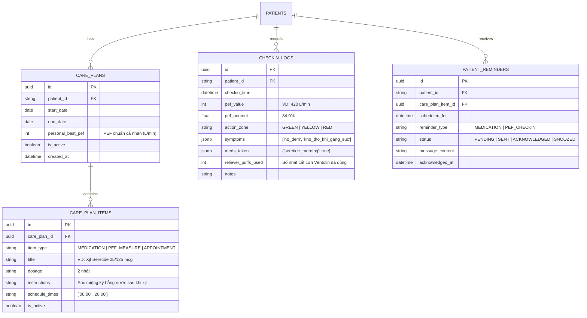

# THIẾT KẾ KỸ THUẬT: PHÂN HỆ CHECK-IN / CARE-PLAN TRACKER, NHẮC THUỐC & LỊCH CHĂM SÓC HEN PHẾ QUẢN (ASTHMA AFTERCARE)

## 1. TỔNG QUAN & MỤC TIÊU HỆ THỐNG
Phân hệ **Check-in / Care-Plan Tracker & Schedule** giải quyết bài toán cốt lõi trong quản lý bệnh nhân Hen phế quản hậu xuất viện:
1. **Chống quên thuốc kiểm soát (Non-adherence):** Nhắc nhở bệnh nhân dùng thuốc duy trì (ICS/LABA) đúng giờ để ngăn ngừa đợt cấp.
2. **Theo dõi biến thiên lưu lượng đỉnh (PEF Tracking):** Ghi nhận chỉ số thổi PEF sáng/tối và phát hiện sớm dấu hiệu đường thở bị co thắt.
3. **Phân vùng hành động tức thời chuẩn GINA (Green / Yellow / Red Action Zones):** Hướng dẫn xử trí ngay tại chỗ và cảnh báo cấp cứu cho điều dưỡng khi rơi vào vùng Đỏ.
4. **Hai Portal chuyên biệt:** Tách bạch trải nghiệm thân thiện cho **Bệnh nhân** (`/patient`) và công cụ quản lý - giám sát chuyên sâu cho **Điều dưỡng/Bác sĩ** (`/nurse`).

---

## 2. NHẬT KÝ QUYẾT ĐỊNH (DECISION LOG)

| Quyết định | Lựa chọn được duyệt | Các phương án đã cân nhắc | Lý do lựa chọn |
| :--- | :--- | :--- | :--- |
| **Đối tượng phục vụ** | Cả hai chiều (Bệnh nhân & Điều dưỡng) | Chỉ Bệnh nhân, hoặc Chỉ Bác sĩ | Cần vòng lặp khép kín: Điều dưỡng giao phác đồ $\leftrightarrow$ Bệnh nhân thực hiện $\leftrightarrow$ Dữ liệu tuân thủ phản hồi cho điều dưỡng. |
| **Bệnh lý trọng tâm** | Hen phế quản (Asthma) | Đa bệnh lý mạn tính tổng quát | Tối ưu hóa sâu cho phác đồ hen chuẩn GINA (PEF Personal Best, thuốc kiểm soát ICS/LABA, thuốc cắt cơn SABA). |
| **Tương tác Check-in** | Chuẩn GINA + Chatbot chủ động (A + C) | Rule-based form đơn thuần | Vừa đảm bảo an toàn lâm sàng vừa tạo sự thân thiện, hỗ trợ người bệnh báo cáo tự nhiên qua chat khi quên điền form. |
| **Kênh nhắc nhở** | In-App Web Notification + Banner + Toast + Chat trigger | Web Push, SMS Brandname, Zalo ZNS | Tối ưu trải nghiệm trực tiếp trên Web App, không phụ thuộc chi phí dịch vụ thứ ba. |
| **Cơ sở dữ liệu** | Lưu trữ quan hệ trong PostgreSQL | Mở rộng file JSON cục bộ | Chuẩn hóa dữ liệu, đảm bảo ACID, truy vấn tính % tuân thủ và đồng bộ thời gian thực mượt mà. |
| **Kiến trúc UI/UX** | 2 Portal riêng biệt (`/patient` & `/nurse`) | 1 trang gộp chung chuyển tab | Vai trò và mục đích khác nhau: Bệnh nhân cần nút to, dễ thao tác; Điều dưỡng cần Dashboard bao quát nhiều bệnh nhân. |

---

## 3. MÔ HÌNH DỮ LIỆU POSTGRESQL (DATABASE SCHEMA)

---

## 4. CHI TIẾT LOGIC BACKEND & API (FASTAPI)

### 4.1. Router Endpoints Đề xuất
- **Nhóm Care Plans (Điều dưỡng & Bệnh nhân):**
  - `GET /api/v1/care-plans/{patient_id}`: Lấy phác đồ điều trị và checklist nhiệm vụ hôm nay.
  - `POST /api/v1/care-plans/`: Tạo mới hoặc cập nhật phác đồ thuốc / giờ đo PEF.
- **Nhóm Check-in & Lâm sàng:**
  - `POST /api/v1/checkin/`: Bệnh nhân gửi báo cáo chỉ số PEF và triệu chứng.
    - *Xử lý logic:* So sánh với `personal_best_pef` để phân vùng Xanh ($\ge 80\%$), Vàng ($50-79\%$), Đỏ ($< 50\%$ hoặc cờ đỏ khó thở dữ dội).
    - *Phản hồi:* Chỉ dẫn hành động tức thì (dùng SABA hay gọi 115).
  - `GET /api/v1/checkin/history/{patient_id}`: Lấy lịch sử check-in phục vụ vẽ biểu đồ và hiển thị lịch tháng.
- **Nhóm Nhắc nhở & Thuốc (Reminders):**
  - `GET /api/v1/reminders/active/{patient_id}`: Lấy các nhắc nhở đang chờ xác nhận (uống thuốc, đo PEF).
  - `POST /api/v1/reminders/{reminder_id}/acknowledge`: Xác nhận đã uống thuốc / đo PEF.
  - `POST /api/v1/reminders/{reminder_id}/snooze`: Hoãn nhắc lại sau 15 phút.
- **Nhóm Tương tác Chatbot chủ động (Proactive Bot):**
  - `GET /api/v1/chat/proactive-greeting/{patient_id}`: Tự động tạo tin nhắn mở lời nếu bệnh nhân quá giờ check-in.

---

## 5. THIẾT KẾ GIAO DIỆN NGƯỜI DÙNG (FRONTEND UI/UX)

### 5.1. Trang Bệnh nhân (`/patient` hoặc View "Bệnh nhân")
1. **Banner Nhắc nhở & Báo động (Top Banner):**
   - Màu sắc theo ngữ cảnh: Xanh (Đã hoàn thành), Cam (Đến giờ thuốc/đo PEF), Đỏ (Cảnh báo vùng nguy hiểm).
   - Nút hành động nhanh: `[Đã xịt thuốc]` | `[Nhắc lại sau 15p]`.
2. **Lịch Chăm Sóc Trực Quan (Interactive Care Calendar):**
   - Lưới tháng hiển thị chấm màu trạng thái sức khỏe: 🟢 Tốt | 🟡 Cảnh báo | 🔴 Nguy cơ.
   - Bấm vào ngày để xem chi tiết các lần xịt thuốc và số đo PEF trong ngày đó.
3. **Check-in Nhanh Trong 1 Phút:**
   - Thanh trượt hoặc ô nhập chỉ số PEF kèm thanh màu trực quan nhảy theo vùng GINA.
   - Các nút chọn triệu chứng dạng thẻ bấm nhanh (Ho đêm, Khò khè, Khó thở khi gắng sức).
4. **Chatbot Đồng hành:**
   - Cửa sổ chat có khả năng nhận dữ liệu check-in tự nhiên bằng văn bản khi bệnh nhân ngại điền form.

### 5.2. Trang Điều dưỡng (`/nurse` hoặc View "Điều dưỡng")
1. **Bảng Triage Giám sát Toàn diện:**
   - Danh sách bệnh nhân được sắp xếp theo độ ưu tiên: Bệnh nhân **Vùng Đỏ** và **Quên thuốc $\ge 2$ ngày** đưa lên đầu danh sách.
   - Chỉ số tuân thủ điều trị (% Adherence rate) hiển thị trực quan.
2. **Công cụ Thiết lập Phác đồ (Care Plan Builder):**
   - Giao diện chọn thuốc kiểm soát, liều xịt, khung giờ nhắc nhở.
   - Cài đặt `personal_best_pef` và lưu ý lâm sàng đặc biệt.
3. **Biểu đồ Dao động Lâm sàng (Clinical Charting):**
   - Biểu đồ đường dao động PEF sáng/tối theo thời gian (PEF Variability Trend).
   - Nhật ký số lần phải xịt thuốc cắt cơn Ventolin để đánh giá mức độ kiểm soát hen (GINA Assessment).
