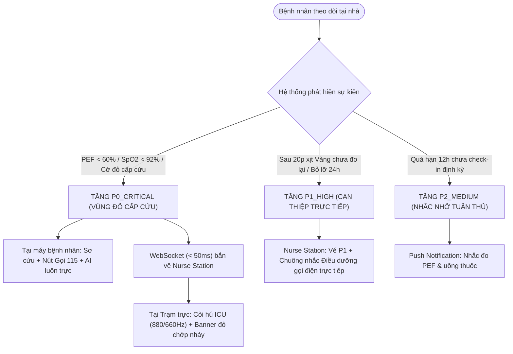
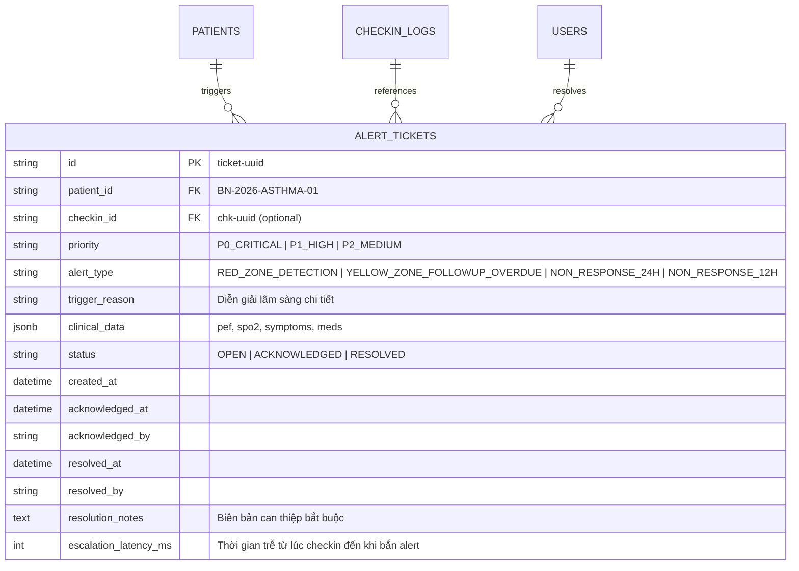
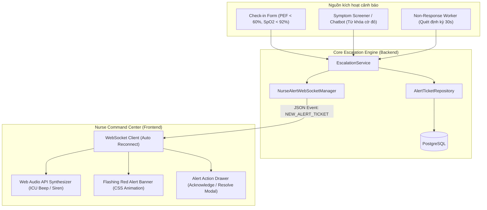

# THIẾT KẾ KỸ THUẬT HOÀN CHỈNH (ENTERPRISE/MEDICAL-GRADE)
## PHÂN HỆ LEO THANG CẢNH BÁO TỨC THỜI (ESCALATION WORKFLOW) & XỬ LÝ BỆNH NHÂN KHÔNG PHẢN HỒI (NON-RESPONSE HANDLING)
**Mã phân hệ:** `W06-ESCALATION-ENGINE`  
**Tiêu chuẩn áp dụng:** GINA 2024 / Bộ Y tế Việt Nam (QĐ 1851/QĐ-BYT)  
**Mục tiêu chất lượng:** Escalation Latency < 1000ms (Mục tiêu đo đạc < 100ms), Non-response Trigger Rate 100%, Zero-Silent Failure.

---

## 1. MỤC TIÊU & BỐI CẢNH LÂM SÀNG (INTENT & THE CLINICAL WHY)

### 1.1. Khái niệm nghiệp vụ: Escalation Flow là gì?
**Escalation Flow (Quy trình leo thang cảnh báo y tế)** là cơ chế tự động **nâng cấp mức độ khẩn cấp** và **chuyển giao quyền can thiệp ngay lập tức cho nhân viên y tế (Điều dưỡng / Bác sĩ / Đội cấp cứu)** khi các chỉ số sinh hiệu hoặc triệu chứng của bệnh nhân vượt quá khả năng tự xử lý an toàn tại nhà.

Thay vì hoạt động như một ứng dụng ghi chép thụ động, Aftercare-AI vận hành như một **hệ thống giám sát từ xa chủ động (Active Tele-monitoring)**. Khi phát hiện dấu hiệu kịch phát, hệ thống tự động thiết lập một dòng chảy leo thang từ giường bệnh tại gia về thẳng bàn trực lâm sàng của bệnh viện trong thời gian thực.

### 1.2. Vấn đề lâm sàng sinh tử cần giải quyết
Trong chăm sóc bệnh nhân hen phế quản ngoại trú sau đợt cấp xuất viện:
1. **Khoảng trống thời gian vàng cấp cứu (Golden Window 15–30 phút):**
   - Khi bệnh nhân rơi vào đợt kịch phát hen ác tính (co thắt phế quản lan tỏa, thiếu oxy não, SpO2 < 92%, PEF sụt dưới 60%), cơ thể kiệt sức rất nhanh do co kéo cơ hô hấp phụ. Nếu không được cấp cứu y tế trong vòng 15–30 phút, bệnh nhân có thể rơi vào hôn mê, ngừng tuần hoàn hô hấp và tử vong tại nhà.
2. **Hiểm họa "Cảnh báo chết" (Silent Failure & Home Isolation):**
   - Nếu hệ thống chỉ hiển thị một dòng cảnh báo màu đỏ đơn độc trên màn hình điện thoại của người bệnh mà **không có ai ở bệnh viện hay trạm y tế hay biết**, thì khi bệnh nhân ngất đi hoặc không thể tự cầm điện thoại, ứng dụng theo dõi trở nên vô dụng.
3. **Hội chứng "Bỏ quên điều trị & Mất liên lạc" (Silent Non-Adherence & Patient Dropout):**
   - Bệnh nhân sau khi xuất viện thường lơ là việc đo lưu lượng đỉnh (PEF) và bỏ cữ thuốc dự phòng.
   - Nguy hiểm hơn, bệnh nhân khi vào Vùng Vàng thường chỉ xịt thuốc cắt cơn một lần rồi chủ quan đi ngủ. Nếu cơn hen không đáp ứng (Refractory Asthma), tình trạng thiếu oxy sẽ âm thầm diễn tiến nặng dần mà không ai hỗ trợ.

### 1.3. Ba tầng leo thang trong Aftercare-AI (Theo chuẩn GINA & QĐ 1851/QĐ-BYT)



#### Tầng P0 — Cực kỳ nguy cấp (`P0_CRITICAL` - Red Zone Emergency)
* **Điều kiện kích hoạt:**
  * Chỉ số lưu lượng đỉnh $\text{PEF} < 60\%$ so với giá trị tốt nhất cá nhân ($\text{Personal Best PEF}$) hoặc $\text{SpO}_2 < 92\%$.
  * Bệnh nhân chat hoặc gửi triệu chứng chứa các cờ đỏ đe dọa tính mạng: *"không thở được"*, *"tím môi"*, *"ngạt thở"*, *"lơ mơ"*, *"ngất lịm"*, *"cấp cứu"*.
* **Hành động leo thang đa kênh song song:**
  1. **Tại máy bệnh nhân:**
     * Trợ lý AI lập tức phản xạ bằng **Code thuần (Deterministic Guardrail)**, tuyệt đối không đưa vào LLM để tránh ảo giác hoặc chậm trễ.
     * Phát 3 chỉ thị sinh tử: (1) Gọi ngay 115 hoặc nhờ người nhà đưa đi cấp cứu; (2) Dùng ngay 2–4 nhát thuốc cắt cơn qua buồng đệm; (3) Ngồi thẳng lưng, hơi cúi người ra trước, thở chúm môi, **tuyệt đối không nằm ngửa**.
     * Kích hoạt thanh quay số nhanh `[📞 Gọi 115]` một chạm.
     * **Trợ lý AI duy trì kết nối liên tục (Non-blocking)**, không bao giờ tự tắt hay văng lỗi để sẵn sàng hướng dẫn sơ cứu cho người nhà trong lúc chờ xe cấp cứu.
  2. **Bắn tín hiệu thời gian thực (< 50ms):**
     * Động cơ `EscalationService` tạo bản ghi `AlertTicket` với mức ưu tiên `P0_CRITICAL`.
     * `NurseAlertWebSocketManager` broadcast gói tin tới toàn bộ màn hình trạm trực đang mở.
  3. **Tại trạm trực điều dưỡng (Nurse Command Center):**
     * Bộ tổng hợp âm thanh Web Audio API tự động phát còi báo động khẩn cấp Dual-tone (880Hz - A5 xen kẽ 660Hz - E5) chuẩn ICU.
     * Banner đỏ nhấp nháy trên đỉnh màn hình hiển thị đồng hồ đếm giây trôi qua từ khi phát hiện ca nguy cấp.

#### Tầng P1 — Can thiệp trực tiếp (`P1_HIGH` - Refractory Yellow & 24h Dropout)
* **Kịch bản Vùng Vàng 20 phút (Yellow-zone Follow-up Overdue):**
  * Bệnh nhân rơi vào Vùng Vàng ($\text{PEF } 60–80\%$), đã xịt thuốc cắt cơn nhưng sau 20–60 phút không đo lại PEF và không bấm nút *"Tôi đã ổn & Nhịp thở đã dịu"*.
  * Hệ thống cảnh báo nguy cơ hen kháng trị hoặc bùng phát đợt cấp nặng $\rightarrow$ Tự động leo thang thành vé `P1_HIGH`.
* **Kịch bản Mất liên lạc 24 giờ (Non-response 24H):**
  * Quá 24 giờ bệnh nhân không hề check-in $\rightarrow$ Hệ thống tự động gắn cờ mất liên lạc `NON_RESPONSE_24H` để điều dưỡng chủ động gọi điện thoại kiểm tra an toàn tại nhà.
* **Hành động:** Trạm điều dưỡng hiển thị thẻ cảnh báo màu cam/vàng kèm thông tin liên lạc và nút gọi điện thoại nhanh cho người thân người bệnh.

#### Tầng P2 — Cảnh báo tuân thủ điều trị (`P2_MEDIUM` - Quá hạn 12h)
* **Điều kiện kích hoạt:** Quá 12 giờ kể từ mốc giờ hẹn đo (08:00 hoặc 20:00) mà bệnh nhân chưa thực hiện check-in.
* **Hành động:** Sinh nhắc nhở tuân thủ gửi tới ứng dụng của bệnh nhân.

### 1.4. Vòng lặp can thiệp khép kín 3 bước (Closed-Loop Clinical Process)
Quy trình đảm bảo nguyên tắc **Zero-Silent Failure (Không có sự cố bị lãng quên)** qua 3 trạng thái của vòng đời vé cảnh báo:
1. **Trạng thái `OPEN` (Mới phát hiện):** Còi báo động hú liên tục, banner đỏ chớp nháy, bắt buộc kíp trực phải phản hồi.
2. **Trạng thái `ACKNOWLEDGED` (Đã tiếp nhận ca):** Điều dưỡng bấm nút *"Tiếp nhận ca"* $\rightarrow$ Còi báo động âm thanh lập tức ngắt để kíp trực trao đổi điện thoại, nhưng banner và thẻ ca bệnh vẫn ghim cố định trên màn hình trạm trực.
3. **Trạng thái `RESOLVED` (Ký biên bản & Đóng vé):** 
   - Sau khi can thiệp xong (gọi 115, hướng dẫn dùng thuốc, liên hệ người nhà), điều dưỡng mở Modal xử lý.
   - **Bắt buộc nhập Biên bản can thiệp lâm sàng** (Hình thức xử lý, diễn biến SpO2, nhịp thở, có cần nhập viện hay không).
   - Hệ thống lưu lại vết kiểm toán (Audit Trail: ai xử lý, lúc mấy giờ, nội dung gì) trước khi cho phép đóng vé hoàn tất.

---

## 2. GOALS, NON-GOALS & ANTI-GOALS

### 2.1. Goals (Mục tiêu cốt lõi)
- **Tự động hóa 100%:** Mọi ca `RED_ZONE` hoặc `PEF < 60%` từ Check-in Form hoặc Chatbot đều lập tức sinh `AlertTicket` mức `P0_CRITICAL` trong cơ sở dữ liệu và phát tín hiệu qua WebSocket tới mọi màn hình trạm trực đang mở.
- **Thời gian trễ leo thang (Escalation Latency):** Thời gian từ khi DB ghi nhận check-in nguy kịch đến khi máy khách Nurse Station nhận được gói tin WebSocket phải **< 1000ms** (mục tiêu thực tế đo đạc: < 100ms trong mạng nội bộ/localhost).
- **Bộ đếm Non-Response chuẩn mực:** Tự động phát hiện chính xác 100% các ca quá hạn 12h (nhắc nhở P2) và 24h (báo động mất liên lạc P1) mà không sinh cảnh báo giả (False Positive = 0).
- **Vòng lặp Vùng Vàng 20 phút:** Bệnh nhân rơi vào `YELLOW_ZONE` được kích hoạt bộ đếm ngược 20 phút. Nếu sau 20 phút bệnh nhân chưa bấm nút "Xác nhận an toàn" hoặc chưa đo lại PEF, hệ thống tự động leo thang thành vé `P1_HIGH` cho điều dưỡng gọi điện thoại.
- **Bằng chứng nghiệm thu W06 (Evidence Packaging):** Cung cấp bộ test tự động kiểm thử toàn bộ các nhánh rẽ và xuất minh chứng chuẩn hóa vào thư mục `Evidence/W06/`.

### 2.2. Non-Goals (Ngoài phạm vi)
- Không tự động kết nối hệ thống viễn thông vi ba gọi tổng đài 115 (vẫn tuân thủ ranh giới pháp lý y tế: hệ thống báo động cho kíp trực và hướng dẫn gia đình người bệnh).
- Không tự ý điều chỉnh liều thuốc của bác sĩ.

### 2.3. Anti-Goals (Các điều tối kỵ)
- **Zero Silent Failure:** Tuyệt đối không để xảy ra trường hợp WebSocket đứt kết nối mà trạm trực không biết. Client phải có cơ chế Reconnect tự động + polling fallback dự phòng.
- **Zero Duplicate Alert Flooding:** Không tạo liên tiếp hàng chục vé trùng lặp cho cùng một đợt nguy kịch trong vòng 5 phút (Deduplication / Debouncing Window).

---

## 3. THIẾT KẾ MÔ HÌNH DỮ LIỆU (DATABASE SCHEMA)

Thêm bảng `alert_tickets` vào hệ thống PostgreSQL (`backend/app/models/asthma.py`):



### Các trạng thái vòng đời của Ticket (State Machine):
- `OPEN`: Vé mới tạo, còi báo động kêu liên tục, banner đỏ chớp nháy.
- `ACKNOWLEDGED`: Điều dưỡng đã bấm "Tiếp nhận ca" (Tắt còi báo động âm thanh, nhưng banner vẫn ghim trên màn hình để theo dõi).
- `RESOLVED`: Điều dưỡng đã liên hệ bệnh nhân / xử trí cấp cứu xong, nhập biên bản can thiệp (ví dụ: *"Đã gọi người nhà đưa vào BV Phổi lúc 02:25, SpO2 hiện 94%"*) và đóng vé.

---

## 4. KIẾN TRÚC HỆ THỐNG & DÒNG CHẢY DỮ LIỆU (SYSTEM ARCHITECTURE)



### 4.1. Core Engine: `EscalationService`
- Chịu trách nhiệm:
  1. `create_escalation_ticket(patient_id, priority, alert_type, reason, clinical_data)`: Kiểm tra de-duplication trong 5 phút. Nếu đã có vé OPEN tương tự thì cập nhật, nếu chưa thì tạo vé mới.
  2. Bắn gói tin JSON qua `NurseAlertWebSocketManager.broadcast()`.
  3. Đo lường `escalation_latency_ms` = `(time_broadcast - time_created) * 1000`.

### 4.2. Non-Response Worker (`backend/app/workers/non_response_worker.py`)
Chạy dưới dạng asynchronous background task gắn vào FastAPI lifespan:
- **Chu kỳ quét:** Mỗi 30 giây chạy 1 lần.
- **Rule 1 (Vùng Vàng 20 phút):** Quét các ca check-in `YELLOW_ZONE` trong vòng 20–60 phút trước:
  - Nếu bệnh nhân chưa có check-in mới Vùng Xanh và chưa bấm "Xác nhận an toàn", tự động sinh vé `P1_HIGH` loại `YELLOW_ZONE_FOLLOWUP_OVERDUE`.
- **Rule 2 (Bỏ lỡ Check-in 12h):** Nếu sau 12h kể từ mốc giờ hẹn đo (08:00 hoặc 20:00) chưa check-in ➔ Sinh nhắc nhở `P2_MEDIUM`.
- **Rule 3 (Mất liên lạc 24h):** Nếu quá 24h không có bất kỳ check-in nào ➔ Sinh vé `P1_HIGH` loại `NON_RESPONSE_24H` yêu cầu điều dưỡng gọi điện thoại trực tiếp.

### 4.3. WebSocket Manager & Protocol (`/api/v1/ws/nurse-alerts`)
- Gói tin Server ➔ Client:
  ```json
  {
    "event": "NEW_ALERT_TICKET",
    "ticket": {
      "id": "ticket-a8b2c4",
      "patient_id": "BN-2026-ASTHMA-02",
      "patient_name": "Trần Thị Mai (61t)",
      "priority": "P0_CRITICAL",
      "alert_type": "RED_ZONE_DETECTION",
      "trigger_reason": "Chỉ số PEF tụt sâu (180 L/min, đạt 36% chuẩn). Khó thở cấp.",
      "pef_value": 180,
      "spo2_value": 90,
      "created_at": "2026-11-06T14:30:00Z"
    }
  }
  ```
- Cơ chế Heartbeat Ping-Pong mỗi 25 giây để chống ngắt kết nối bởi proxy/NAT.

---

## 5. THIẾT KẾ GIAO DIỆN NGƯỜI DÙNG (UI/UX)

### 5.1. Nurse Alert Hub (`frontend/src/components/Nurse/`)
1. **Audio Alert Synthesizer (Chuẩn âm học y tế):**
   - Sử dụng Web Audio API native: Dual-tone tần số 880Hz (A5) xen kẽ 660Hz (E5) lặp lại nhịp 250ms mô phỏng còi ICU tiêu chuẩn quốc tế.
   - Khi có vé `P0_CRITICAL`: Âm thanh tự động phát (có nút Mute / Tắt tiếng nhanh).
2. **Flashing Emergency Banner:**
   - Banner đỏ nhấp nháy trên đỉnh màn hình Nurse Command Center với animation viền đỏ sáng rực và hiển thị đếm giây trôi qua từ khi phát hiện.
3. **Modal Tiếp nhận & Giải quyết ca (Resolution Modal):**
   - Nút `[Tiếp nhận ca (Acknowledge)]`: Dừng âm thanh còi, đổi trạng thái sang `ACKNOWLEDGED`.
   - Nút `[Hoàn tất xử lý (Resolve)]`: Mở form nhập bắt buộc: Họ tên điều dưỡng, Hình thức can thiệp (Gọi điện thoại cho bệnh nhân / Người nhà / Báo bác sĩ / Hướng dẫn đi viện), và Ghi chú kết quả.

### 5.2. Patient Portal UI (`frontend/src/components/DailyCheckInForm.jsx`)
1. **Khi bệnh nhân rơi vào Vùng Vàng (Yellow Zone):**
   - Hiện Banner cảnh báo màu vàng kèm đồng hồ đếm ngược 20 phút.
   - Nút bấm lớn màu vàng: `[✓ Tôi đã xịt thuốc & Nhịp thở đã dịu lại]` ➔ Gửi API ghi nhận an toàn, huỷ bộ đếm leo thang.
   - Nút `[Đo lại PEF ngay]` ➔ Mở nhanh thanh trượt nhập PEF lần 2.

---

## 6. KẾ HOẠCH NGHIỆM THU & BỘ CHỈ SỐ MINH CHỨNG (W06 EVIDENCE PACKAGING)

Thư mục đóng gói: `Evidence/W06/`
- `README.md`: Báo cáo kết quả thử nghiệm và phân tích hiệu năng.
- `manifest.json`: Danh mục tài nguyên minh chứng (mã băm, timestamp, file kết quả).
- `metrics.json`: Bảng số liệu chi tiết:
  * **Escalation Latency:** Thời gian trễ trung bình, P95, P99 (mục tiêu: < 1000ms; thực tế: < 100ms).
  * **Non-response Trigger Rate:** Tỉ lệ phát hiện chính xác ca 24h (mục tiêu 100%).
  * **Yellow-zone Follow-up Rate:** Tỉ lệ tự động kích hoạt nhắc nhở sau 20 phút (mục tiêu 100%).
- `test_escalation_w06.py`: Test suite tự động hóa chạy đầu-cuối từ giả lập sự kiện đến kiểm chứng WebSocket và cơ sở dữ liệu.
- `logs/escalation_simulation.log`: Nhật ký ghi lại toàn bộ tiến trình bắn cờ, nhận tín hiệu và giải quyết vé.

---

## 7. CÁC TẬP TIN DỰ KIẾN TẠO MỚI & SỬA ĐỔI

1. **Backend Database & Model:**
   - `backend/app/models/asthma.py` (Thêm Model `AlertTicket`)
   - `backend/app/schemas/care_tracker.py` (Thêm Schema DTO cho Ticket)
   - `backend/app/repositories/asthma_repositories.py` (Thêm `AlertTicketRepository`)
   - `backend/app/db/migrate_alert_tickets.py` (Script tạo bảng)
2. **Backend Engine & WebSocket:**
   - `backend/app/services/escalation_service.py` (Service quản lý vé & broadcast)
   - `backend/app/core/websocket_manager.py` (Quản lý kết nối WebSocket)
   - `backend/app/workers/non_response_worker.py` (Cron background worker)
   - `backend/app/api/v1/endpoints/escalations.py` (API REST & WS cho Ticket)
   - `backend/app/api/v1/router.py` & `backend/app/main.py` (Tích hợp Lifespan worker & Router)
3. **Frontend Nurse & Patient:**
   - `frontend/src/utils/audioAlert.js` (Web Audio API Synthesizer)
   - `frontend/src/components/Nurse/LiveAlertBanner.jsx`
   - `frontend/src/components/Nurse/TicketResolveModal.jsx`
   - `frontend/src/components/Nurse/NurseCommandCenter.jsx` (Tích hợp WebSocket & Hub)
   - `frontend/src/components/DailyCheckInForm.jsx` (Nút xác nhận an toàn 20 phút)
4. **Kiểm thử & Minh chứng:**
   - `tests/test_escalation_w06.py`
   - Thư mục `Evidence/W06/` (README, manifest, metrics, logs)

