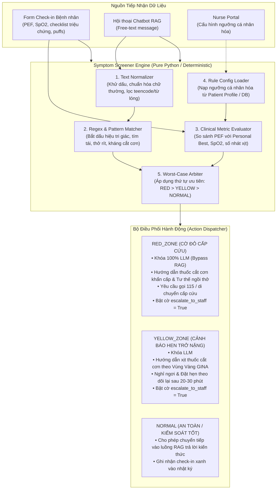

# THIẾT KẾ KỸ THUẬT: SYMPTOM SCREENER ENGINE (RULE-BASED & RISK LEVELS)
## Phân hệ Sàng lọc Triệu chứng & Phân tầng Nguy cơ Không Chẩn đoán

---

## 1. TỔNG QUAN & RANH GIỚI PHÁP LÝ (CLINICAL SCOPE & DISCLAIMER)

### 1.1. Mục tiêu cốt lõi
Phân hệ **Symptom Screener Engine** là tầng bảo vệ an toàn y tế tiền xử lý (Pre-LLM Safety Layer) có nhiệm vụ:
1. **Sàng lọc triệu chứng tự động:** Tiếp nhận báo cáo từ cả Form Check-in hàng ngày (dữ liệu có cấu trúc) và Tin nhắn hội thoại tự do (văn bản tự nhiên).
2. **Phân tầng mức độ nguy cơ lâm sàng (3 cấp GINA):** Xác định tức thời trạng thái `RED_ZONE` (Cấp cứu), `YELLOW_ZONE` (Cảnh báo hen trở nặng) hoặc `NORMAL` (An toàn).
3. **Điều phối hành động tại chỗ & Escalation:** Hướng dẫn bệnh nhân xử trí theo Kế hoạch hành động cá nhân (Asthma Action Plan) đã được phê duyệt và kích hoạt còi báo động khẩn cấp tới portal của Điều dưỡng/Bác sĩ.

### 1.2. Cam kết Ranh giới Y tế: TUYỆT ĐỐI KHÔNG CHẨN ĐOÁN
* **Không đưa ra kết luận bệnh học:** Hệ thống không bao giờ phát ngôn các kết luận như *"Bạn bị viêm phổi"*, *"Bạn mắc cơn hen ác tính"*, v.v.
* **Định hướng hành động (Action-Oriented):** Chỉ phân loại mức độ khẩn cấp, đánh giá mức độ tuân thủ, và hướng dẫn sơ cứu/dùng thuốc cắt cơn theo chỉ định có sẵn của bác sĩ điều trị.
* **Disclaimer bắt buộc trên mọi phản hồi:**
  > *"Lưu ý y tế: Kết quả sàng lọc chỉ nhằm đánh giá mức độ khẩn cấp và hướng dẫn xử trí ban đầu, tuyệt đối không thay thế chẩn đoán hoặc chỉ định trực tiếp từ bác sĩ chuyên khoa."*

---

## 2. NHẬT KÝ QUYẾT ĐỊNH THIẾT KẾ (DECISION LOG)

| STT | Quyết định | Lựa chọn được duyệt | Các phương án đã cân nhắc | Lý do lựa chọn |
| :-: | :--- | :--- | :--- | :--- |
| **1** | **Kiến trúc phân hệ** | **Module Engine độc lập (`backend/app/clinical_agents/screener/`)** | Gộp trực tiếp vào TriageAgent cũ, hoặc làm Widget độc lập | Chuẩn Single Responsibility; làm Single Source of Truth cho cả Chatbot và Form Check-in tái sử dụng; dễ dàng kiểm thử 100% độc lập. |
| **2** | **Mô hình Phân tầng Nguy cơ** | **3 Cấp GINA (`RED_ZONE`, `YELLOW_ZONE`, `NORMAL`)** | 4 cấp (thêm ORANGE), 5 cấp (ESI Triage) | Tương thích tuyệt đối với Kế hoạch Hành động Hen GINA và dữ liệu hồ sơ bệnh nhân hiện hành của hệ thống. |
| **3** | **Định dạng Dữ liệu Đầu vào** | **Hybrid Input (Cấu trúc + Văn bản tự do)** | Chỉ cấu trúc, hoặc chỉ Free-text | Phù hợp thực tế lâm sàng: Bệnh nhân có thể điền form sinh hiệu định kỳ hoặc nhắn tin tự do khi hoảng loạn/khó thở. |
| **4** | **Cơ chế Ra quyết định** | **Rule-based thuần Python + Worst-Case Arbiter** | Gọi LLM đánh giá, hoặc Học máy ML | Triệt tiêu 100% ảo giác (Zero-Hallucination), độ trễ cực thấp (<10ms), đảm bảo tính tất định (Deterministic) và an toàn sinh mạng. |
| **5** | **Ranh giới Chẩn đoán** | **Tuyệt đối KHÔNG chẩn đoán** | Phỏng đoán bệnh kèm % xác suất | Tuân thủ đạo đức y khoa và phạm vi nghiên cứu; chỉ phân tầng nguy cơ và điều phối phản xạ. |
| **6** | **Khả năng Tùy biến Quy tắc** | **Configurable Rules qua Schema/JSON Profile** | Hardcode tĩnh trong mã nguồn | Cho phép Bác sĩ/Điều dưỡng tùy biến ngưỡng PEF/SpO2 và bổ sung từ khóa theo từng cá nhân mà không cần sửa code. |

---

## 3. KIẾN TRÚC TỔNG THỂ & DÒNG CHẢY DỮ LIỆU



---

## 4. HỢP ĐỒNG DỮ LIỆU (DATA CONTRACTS & SCHEMAS)

### 4.1. Cấu hình Quy tắc Cá nhân hóa (`ScreenerRuleConfig`)
```python
from pydantic import BaseModel, Field
from typing import List, Optional

class ScreenerRuleConfig(BaseModel):
    """Cấu hình ngưỡng quy tắc sàng lọc có thể tùy biến bởi nhân viên y tế."""
    personal_best_pef: int = Field(default=450, description="PEF chuẩn cá nhân tốt nhất (L/min)")
    red_pef_ratio: float = Field(default=0.6, description="Ngưỡng PEF vùng đỏ (< 60%)")
    yellow_pef_ratio: float = Field(default=0.8, description="Ngưỡng PEF vùng vàng (< 80%)")
    red_spo2_threshold: int = Field(default=92, description="Ngưỡng SpO2 cấp cứu (< 92%)")
    yellow_spo2_threshold: int = Field(default=95, description="Ngưỡng SpO2 cảnh báo (< 95%)")
    max_reliever_puffs_24h: int = Field(default=4, description="Giới hạn nhát xịt cắt cơn/ngày")
    custom_red_keywords: List[str] = Field(default_factory=list, description="Từ khóa cờ đỏ bổ sung")
    custom_yellow_keywords: List[str] = Field(default_factory=list, description="Từ khóa cảnh báo bổ sung")
```

### 4.2. Dữ liệu Đầu vào Đa phương thức (`ScreenerInput`)
```python
class ScreenerInput(BaseModel):
    patient_id: str
    free_text: Optional[str] = None          # Đoạn văn bản chat hoặc ghi chú tự do
    pef_value: Optional[int] = None          # Chỉ số PEF thực tế đo được (L/min)
    spo2: Optional[int] = None               # Chỉ số SpO2 (%)
    reliever_puffs: Optional[int] = 0        # Số nhát thuốc cắt cơn đã dùng trong 24h
    selected_symptoms: List[str] = []        # Danh mục mã triệu chứng được tick chọn
    config_override: Optional[ScreenerRuleConfig] = None
```

### 4.3. Dữ liệu Đầu ra Chuẩn mực Không Chẩn đoán (`ScreenerResult`)
```python
from typing import Literal

class ScreenerResult(BaseModel):
    risk_level: Literal["RED_ZONE", "YELLOW_ZONE", "NORMAL"]
    matched_flags: List[str]                 # Mã cờ kích hoạt: ["spo2_critical", "reliever_refractory"]
    matched_reasons: List[str]               # Diễn giải lâm sàng khách quan (không chứa tên bệnh)
    action_instructions: str                 # Chỉ dẫn hành động tức thời theo hồ sơ bệnh nhân
    escalate_to_staff: bool                  # Cờ kích hoạt thông báo tới cổng Điều dưỡng
    suggested_follow_up_minutes: Optional[int] # Thời gian cần đánh giá lại (VD: 20-30 phút)
    disclaimer: str = (
        "Lưu ý y tế: Kết quả sàng lọc chỉ nhằm đánh giá mức độ khẩn cấp và "
        "hướng dẫn xử trí ban đầu, tuyệt đối không thay thế chẩn đoán của bác sĩ chuyên khoa."
    )
```

---

## 5. BẢNG QUY TẮC SÀNG LỌC CHI TIẾT (CLINICAL RULES MATRIX)

| Tầng rủi ro | Nhóm tiêu chí | Dấu hiệu kích hoạt (Trigger Criteria) | Hành động quy định (Protocol) | Escalation |
| :--- | :--- | :--- | :--- | :---: |
| **RED_ZONE**<br>*(Cấp cứu khẩn cấp)* | **Chỉ số sinh hiệu** | • $\text{PEF} < \text{personal\_best} \times 0.6$<br>• $\text{SpO}_2 < 92\%$ | • Dùng ngay thuốc cắt cơn theo liều khẩn cấp.<br>• Ngồi thẳng lưng, hơi cúi ra trước, thở chúm môi.<br>• Gọi Cấp cứu 115 hoặc di chuyển đến bệnh viện ngay lập tức. | **BẬT (True)**<br>Hú còi đỏ tức thì |
| | **Tri giác suy sụp** | mê man, lơ mơ, ngất, lả đi, gọi không thưa, không tỉnh táo, nằm bất động | | |
| | **Thiếu oxy nghiêm trọng** | tím môi, môi thâm, mặt tím, tím tái, tái mét, móng tay tím | | |
| | **Khó thở dữ dội** | không thở được, nghẹt thở, ngạt thở, thều thào, nói không ra hơi, rút lõm ngực, ngừng thở | | |
| | **Kháng trị cắt cơn** | Xịt thuốc cắt cơn $\ge 2$ lần hoặc dùng ventolin mà vẫn không đỡ, càng khó thở hơn | | |
| | **Tín hiệu cấp cứu** | cấp cứu, gọi 115, đi viện gấp, cứu với, nguy kịch | | |
| **YELLOW_ZONE**<br>*(Cảnh báo hen trở nặng)* | **Chỉ số sinh hiệu** | • $0.6 \times \text{best} \le \text{PEF} < 0.8 \times \text{best}$<br>• $92\% \le \text{SpO}_2 < 95\%$<br>• Số nhát cắt cơn $> 4$ nhát/ngày | • Dùng ngay thuốc cắt cơn theo chỉ định Vùng Vàng.<br>• Nghỉ ngơi tại chỗ, tránh khói bụi, máy lạnh, dị nguyên.<br>• Đánh giá lại sau 20-30 phút; nếu không cải thiện $\to$ chuyển Vùng Đỏ. | **BẬT (True)**<br>Cảnh báo vàng trên bảng theo dõi |
| | **Triệu chứng đêm** | thức giấc ban đêm vì ho/khó thở, ho nhiều về đêm | | |
| | **Đường thở co thắt** | khò khè tăng, tức ngực, nặng ngực, thở dốc khi gắng sức nhẹ | | |
| | **Tăng nhu cầu thuốc** | phải xịt cắt cơn thêm ngoài kế hoạch duy trì | | |
| **NORMAL**<br>*(An toàn / Kiểm soát tốt)* | **Chỉ số sinh hiệu** | • $\text{PEF} \ge \text{personal\_best} \times 0.8$<br>• $\text{SpO}_2 \ge 95\%$ | • Tiếp tục dùng thuốc kiểm soát (ICS/LABA) theo đơn.<br>• Giữ lịch sinh hoạt, tập thở và tái khám định kỳ.<br>• Chuyển câu hỏi sang RAG giải đáp tri thức chuẩn BYT/GINA. | **TẮT (False)** |
| | **Trạng thái** | Không có bất kỳ dấu hiệu cờ đỏ hay vùng vàng nào | | |

---

## 6. CHIẾN LƯỢC KIỂM THỬ AN TOÀN (SAFETY TESTING STRATEGY)

Engine phải đạt tỷ lệ bao phủ kiểm thử tự động 100% đối với các tình huống biên lâm sàng:

1. **Boundary Value Testing (Kiểm thử ranh giới chỉ số):**
   * $\text{PEF} = 59\% \implies \text{RED\_ZONE}$; $\text{PEF} = 60\% \implies \text{YELLOW\_ZONE}$; $\text{PEF} = 80\% \implies \text{NORMAL}$.
   * $\text{SpO}_2 = 91\% \implies \text{RED\_ZONE}$; $\text{SpO}_2 = 92\% \implies \text{YELLOW\_ZONE}$; $\text{SpO}_2 = 95\% \implies \text{NORMAL}$.
2. **Vietnamese Linguistic Variations (Biến thể ngôn ngữ tiếng Việt):**
   * Kiểm thử từ viết tắt/teencode: `"k tho dc"`, `"met la"`, `"tim moi"`.
   * Kiểm thử từ không dấu: `"kho tho qua roi"`, `"cap cuu"`.
3. **Refractory Pattern Matching (Quy tắc xịt không đỡ):**
   * `"Đã xịt 2 nhát ventolin 15 phút trước mà vẫn thấy tức ngực không thở nổi"` $\implies$ Bắt buộc nhảy `RED_ZONE`.
4. **Zero-Diagnosis Assertion (Khẳng định không chẩn đoán):**
   * Duyệt qua toàn bộ `action_instructions` và `matched_reasons` để xác nhận không chứa các từ vựng gán nhãn chẩn đoán bệnh học.
5. **Config Override Integrity:**
   * Thay đổi ngưỡng `red_spo2_threshold = 94` thì $\text{SpO}_2 = 93$ phải lập tức kích hoạt `RED_ZONE`.

---

## 7. THIẾT KẾ GIAO DIỆN TINH GỌN (MINIMALIST UI/UX SPECIFICATION)

Để tránh gây hoảng loạn cho người bệnh và giúp thao tác cấp cứu đạt tốc độ tối đa, giao diện tuân theo nguyên tắc: **Đơn giản, phẳng, rõ ràng, không hiệu ứng rườm rà**.

### 7.1. Điểm chạm 1: Daily Check-in & Action Zone Banner (`ActionZoneBanner.jsx`)
* **Trực quan hóa 3 Vùng (Cards phẳng, viền màu rõ nét):**
  - 🟢 **VÙNG XANH (NORMAL):** Thẻ nền xanh dịu, báo hiệu "Hô hấp ổn định" và nhắc dùng thuốc duy trì đúng giờ.
  - 🟡 **VÙNG VÀNG (YELLOW_ZONE):** Thẻ viền vàng hổ phách, hiển thị ngắn gọn lý do phát hiện (VD: `PEF 68% chuẩn` hoặc `Thức giấc vì khó thở`) và hướng dẫn dùng thuốc cắt cơn theo chỉ định.
  - 🔴 **VÙNG ĐỎ (RED_ZONE):** Thẻ viền đỏ nổi bật, tóm tắt 2 bước sơ cứu khẩn cấp (xịt thuốc cắt cơn + ngồi thẳng cúi nhẹ) kèm nút lớn **[📞 Gọi 115]** kết nối trực tiếp `tel:115`.
* **Medical Disclaimer cố định:** Dòng chữ nhỏ thanh lịch ở chân thẻ: *"Lưu ý: Đánh giá nhằm mục đích hỗ trợ định hướng xử trí, không thay thế chẩn đoán của bác sĩ."*

### 7.2. Điểm chạm 2: Chat Safety Interceptor (`FloatingChatWidget.jsx`)
* **Phản hồi Inline đơn giản:**
  - Khi tin nhắn rơi vào `YELLOW_ZONE`: Bot trả lời ngắn gọn cách xử trí cắt cơn kèm 1 chip nhắc nhỏ.
  - Khi tin nhắn rơi vào `RED_ZONE`: Bot đưa ra khối cảnh báo viền đỏ cô đọng; xuất hiện ngay phía trên ô gõ phím một nút bấm khẩn cấp **[📞 Gọi Cấp Cứu 115]** (1 chạm gọi ngay trên di động/máy tính).
* Giữ nguyên luồng chat tự nhiên, không che khuất màn hình bằng pop-up phức tạp.

### 7.3. Điểm chạm 3: Bảng Giám Sát Điều Dưỡng (`NurseCommandCenter.jsx`)
* **Nhãn trạng thái (Badge) gọn gàng cạnh tên bệnh nhân:**
  - `[🔴 Cấp cứu]`, `[🟡 Cảnh báo]`, `[🟢 Ổn định]`.
* **Dòng thông tin cô đọng:** Khi click vào bệnh nhân, hiển thị nhanh chỉ số sinh hiệu (PEF, SpO2) cùng danh sách lý do kích hoạt (`matched_reasons`), giúp nhân viên y tế nắm bắt tình huống chỉ trong 2 giây.

