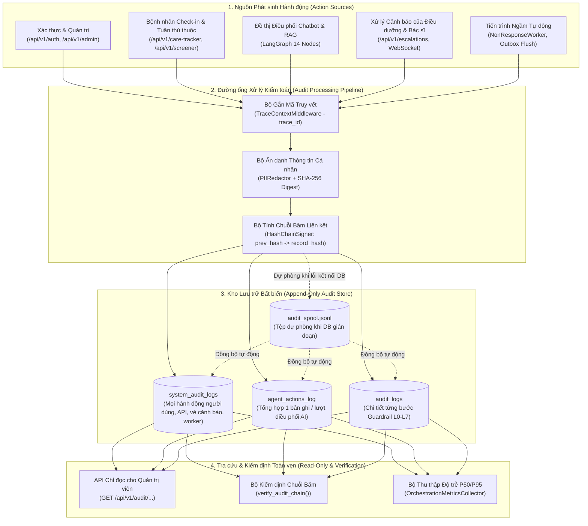

# Đặc tả Thiết kế Cơ chế Nhật ký Kiểm toán Bất biến cho Mọi Hành động Hệ thống (`System-Wide Immutable Audit Log Architecture`)

**Mã tài liệu:** `DOC-AUDIT- ARCHITECTURE-V1`  
**Hệ thống:** `Aftercare-AI` — Hệ thống Theo dõi và Hỗ trợ Chăm sóc Sau xuất viện cho Bệnh nhân Hen phế quản  
**Phạm vi:** Toàn bộ hành động của Người dùng (`Bệnh nhân`, `Điều dưỡng`, `Bác sĩ`, `Quản trị viên`), Hệ thống Dịch vụ Nghiệp vụ (`Authentication`, `Care Tracker`, `Symptom Screener`, `Escalation Engine`), Tiến trình Ngầm (`NonResponseWorker`, `EscalationOutboxDispatcher`) và Đồ thị Điều phối Trí tuệ Nhân tạo (`LangGraph StateGraph`).

---

## 1. Mục tiêu và Nguyên tắc Thiết kế Cốt lõi

Trong hệ thống y tế số hỗ trợ theo dõi bệnh nhân sau xuất viện, nhật ký kiểm toán (`Audit Log`) không đơn thuần là tệp ghi lỗi kỹ thuật (`Application Debug Log`), mà là **bằng chứng pháp lý – lâm sàng (`Clinical & Forensic Evidence`)** để trả lời chính xác 6 câu hỏi cho mọi biến cố:
1. **Ai thực hiện (`Actor`)**: Người bệnh, điều dưỡng, bác sĩ, quản trị viên, tác tử trí tuệ nhân tạo hay tiến trình định kỳ?
2. **Hành động gì (`Action & Event Type`)**: Đăng nhập, gửi phiếu theo dõi lưu lượng đỉnh, hỏi trợ lý ảo, kích hoạt cảnh báo Vùng Đỏ, xác nhận xử lý vé cảnh báo hay thay đổi kế hoạch điều trị?
3. **Trên đối tượng nào (`Target Resource & Patient Scope`)**: Hồ sơ bệnh nhân nào, vé cảnh báo nào, phiên hội thoại nào, đoạn tài liệu y khoa nào?
4. **Khi nào và ở đâu (`Timestamp, Trace, Context`)**: Thời điểm chuẩn `UTC`, mã truy vết xuyên suốt `trace_id`, phiên `session_id`, kênh giao tiếp (`WEB`, `CHAT`, `CHECKIN`, `WORKER`)?
5. **Thay đổi và Quyết định cụ thể là gì (`Before / After State & Rule Verdict`)**: Giá trị trước và sau khi cập nhật (đối với dữ liệu lâm sàng) hoặc mã quy tắc (`rule_id`) và quyết định (`PASSED`, `BLOCKED`, `REWRITTEN`, `ESCALATED`, `FALLBACK`) đối với tác tử trí tuệ nhân tạo?
6. **Bản ghi có bị can thiệp trái phép hay không (`Tamper-Evidence & Immutability`)**: Có cơ chế khóa sửa/xóa (`Append-only`) và chuỗi băm liên kết mật mã (`Cryptographic Hash Chaining`) để phát hiện mọi hành vi chỉnh sửa dữ liệu lịch sử hay không?

### 1.1. Sáu Bất biến Kiểm toán (`Audit Invariants`)

| Mã bất biến | Tên bất biến | Quy tắc cưỡng chế kỹ thuật |
|---|---|---|
| **AUD-INV-1** | **Chỉ thêm mới (`Strict Append-Only`)** | Không một tài khoản nào (kể cả `admin`) được phép thực hiện thao tác `UPDATE` hoặc `DELETE` trên các bảng kiểm toán. Mọi nỗ lực sửa/xóa ở tầng ORM đều ném ngoại lệ `ImmutableAuditRecordError` và bị chặn ở tầng cơ sở dữ liệu bằng `Trigger`. |
| **AUD-INV-2** | **Độ phủ toàn diện 100% hành động (`Complete Action Coverage`)** | Mọi thao tác thay đổi trạng thái (`POST`, `PUT`, `PATCH`, `DELETE`), mọi quyết định phân tầng nguy cơ y tế, mọi lượt thực thi đồ thị điều phối trí tuệ nhân tạo và mọi hành động truy cập hồ sơ bệnh án nhạy cảm đều sinh ít nhất 1 bản ghi kiểm toán có cùng `trace_id`. |
| **AUD-INV-3** | **Không rò rỉ thông tin định danh cá nhân (`Zero Raw PII in Audit`)** | Nội dung văn bản tự do và thông tin chi tiết trước khi ghi vào bảng kiểm toán đều phải đi qua bộ ẩn danh `PIIRedactor` (ẩn họ tên, số điện thoại, căn cước công dân, địa chỉ, thư điện tử), đồng thời lưu kèm mã băm `SHA-256` của thông điệp gốc để đối chiếu toàn vẹn khi cần thiết. |
| **AUD-INV-4** | **Chuỗi băm chống giả mạo (`Tamper-Evident Hash Chain`)** | Mỗi bản ghi kiểm toán lưu `prev_hash` (mã băm của bản ghi liền trước) và `record_hash = SHA256(prev_hash || trace_id || actor_id || action_code || resource_id || payload_json || created_at)`. Nếu bất kỳ dòng nào trong quá khứ bị sửa trực tiếp trên đĩa, quá trình kiểm định chuỗi băm sẽ phát hiện ngay lập tức. |
| **AUD-INV-5** | **Không làm gián đoạn luồng cấp cứu (`Non-Blocking Emergency Path`)** | Việc ghi nhật ký kiểm toán không bao giờ được làm sập hoặc chặn phản hồi cấp cứu Vùng Đỏ (`RED_ZONE`) trả về cho người bệnh; nếu cơ sở dữ liệu kiểm toán tạm thời gián đoạn, bản ghi được lưu vào bộ đệm trong bộ nhớ và tệp dự phòng `audit_spool.jsonl` để đồng bộ lại. |
| **AUD-INV-6** | **Truy vết hợp nhất đa tầng (`Unified Distributed Traceability`)** | Một yêu cầu từ lúc vào cổng `FastAPI` cho tới khi qua đồ thị `LangGraph`, tạo vé trong `EscalationService` và phát thông báo qua `WebSocket` tới màn hình điều dưỡng đều mang cùng một mã `trace_id` duy nhất. |

---

## 2. Kiến trúc Tổng thể Hệ thống Nhật ký Kiểm toán

Hệ thống kiểm toán của `Aftercare-AI` được thiết kế theo mô hình **Ba Phân lớp Nhật ký Bất biến (`Three-Tier Immutable Audit Architecture`)**, kết hợp giữa các bảng đã triển khai trong `backend/app/models/audit.py` và phân lớp mở rộng cho toàn bộ hành động hệ thống:



---

## 3. Phân loại Danh mục Toàn bộ Hành động Cần Ghi Nhật ký (`Action Taxonomy`)

Để không bỏ sót bất kỳ thao tác nào trong hệ thống, mọi hành động được chuẩn hóa theo mã phân nhóm `CATEGORY.ACTION_NAME` thuộc **7 nhóm nghiệp vụ**:

### 3.1. Nhóm 1 — Xác thực, Phiên đăng nhập và Phân quyền (`AUTH.*` & `ADMIN.*`)
| Mã hành động (`action_code`) | Tác nhân (`actor_role`) | Mô tả sự kiện | Mức độ quan trọng |
|---|---|---|---|
| `AUTH.LOGIN_SUCCESS` | `patient`, `nurse`, `admin` | Đăng nhập thành công bằng mật khẩu và khởi tạo phiên làm việc (`UserSession`). | `INFO` |
| `AUTH.LOGIN_FAILED` | `anonymous` | Đăng nhập thất bại (sai tên tài khoản, sai mật khẩu hoặc tài khoản bị vô hiệu hóa). | `WARNING` |
| `AUTH.DEMO_LOGIN` | `patient`, `nurse`, `admin` | Đăng nhập nhanh qua cổng tài khoản trình diễn (`/api/v1/auth/demo-login`). | `INFO` |
| `AUTH.LOGOUT` | `patient`, `nurse`, `admin` | Người dùng chủ động đăng xuất và thu hồi phiên làm việc. | `INFO` |
| `AUTH.ACCESS_DENIED` | `patient`, `nurse`, `anonymous` | Từ chối truy cập do không đủ quyền (`403 Forbidden`) hoặc truy cập trái phép sang hồ sơ bệnh nhân khác. | `HIGH` |
| `ADMIN.USER_SEED` | `admin` | Quản trị viên khởi tạo hoặc cập nhật danh sách tài khoản hệ thống. | `HIGH` |

### 3.2. Nhóm 2 — Hồ sơ Lâm sàng, Kế hoạch Điều trị và Theo dõi Hàng ngày (`CLINICAL.*`)
| Mã hành động (`action_code`) | Tác nhân (`actor_role`) | Mô tả sự kiện | Mức độ quan trọng |
|---|---|---|---|
| `CLINICAL.PROFILE_VIEW` | `patient`, `nurse`, `admin` | Truy cập đọc hồ sơ bệnh án tóm tắt sau xuất viện và kế hoạch hành động hen. | `INFO` |
| `CLINICAL.PEF_CHECKIN_SUBMIT` | `patient`, `nurse` | Ghi nhận kết quả đo lưu lượng đỉnh (`PEF`), `SpO2`, số nhát thuốc cắt cơn và triệu chứng hàng ngày. | `INFO` |
| `CLINICAL.MEDICATION_ADHERENCE_LOG` | `patient`, `nurse` | Đánh dấu hoàn thành hoặc bỏ lỡ liều thuốc kiểm soát trong danh mục chăm sóc (`CarePlanItem`). | `INFO` |
| `CLINICAL.SCREENER_EVALUATE` | `system`, `patient` | Thực thi bộ sàng lọc triệu chứng tất định (`SymptomScreenerEngine`) và trả về phân tầng `NORMAL`, `YELLOW_ZONE` hoặc `RED_ZONE`. | `HIGH` |

### 3.3. Nhóm 3 — Điều phối Tác tử Trí tuệ Nhân tạo và Hàng rào An toàn (`AGENT.*` & `GUARD.*`)
| Mã hành động (`action_code`) | Tác nhân (`actor_role`) | Mô tả sự kiện | Mức độ quan trọng |
|---|---|---|---|
| `AGENT.GRAPH_TURN_COMPLETED` | `agent` | Hoàn tất 1 lượt thực thi đồ thị điều phối `LangGraph` (ghi vào bảng `agent_actions_log`). | `INFO` |
| `GUARD.L0_CONTEXT_LOADED` | `agent` | Tải hồ sơ bệnh nhân và kiểm tra trạng thái khóa phiên Vùng Đỏ (`session_locked_red`). | `INFO` |
| `GUARD.L0_INPUT_SANITIZED` | `agent` | Chuẩn hóa Unicode `NFC`, loại bỏ ký tự điều khiển và kiểm tra độ dài đầu vào. | `INFO` |
| `GUARD.L1_SAFETY_TRIAGE` | `agent` | Phân tầng nguy cơ sinh mạng (`ASTHMA-RED-01`, `ASTHMA-YEL-01`, `ASTHMA-GRN-01`) trước khi gọi mô hình. | `CRITICAL` (nếu Đỏ/Vàng) |
| `GUARD.L2_POLICY_BLOCKED` | `agent` | Chặn tin nhắn vi phạm chính sách đầu vào (`POL-SELFHARM`, `POL-INJECT`, `POL-MED-STOP`, `POL-MED-DOSE`, `POL-RX-NEW`, `POL-DIAG`, `POL-OOS`). | `WARNING` / `HIGH` |
| `GUARD.L3_EVIDENCE_GATE` | `agent` | Đánh giá độ tin cậy của đoạn tài liệu truy xuất so với ngưỡng `tau = 0.35` (`EVIDENCE-GATE-PASS` hoặc `EVIDENCE-GATE-REJECT`). | `INFO` |
| `GUARD.L4_LLM_GENERATED` | `agent` | Gọi mô hình ngôn ngữ lớn với dữ liệu đã ẩn danh `PII` và ranh giới thẻ `XML`. | `INFO` |
| `GUARD.L5_OUTPUT_GUARD` | `agent` | Kiểm duyệt đầu ra (`OUT-LEAK`, `OUT-RESCREEN`, `OUT-FALSE-REASSURE`, `OUT-STOP-MED`, `OUT-DIAG`, `OUT-DOSE-LEAK`, `OUT-MED-ALLOW`, `OUT-CITE`, `OUT-DISCLAIMER`). | `HIGH` (nếu `FAIL`/`RISK_UP`) |
| `GUARD.NODE_SAFE_FALLBACK` | `agent` | Bắt ngoại lệ runtime tại nút đồ thị bằng `@safe_node` và chuyển về phản hồi dự phòng an toàn. | `ERROR` |

### 3.4. Nhóm 4 — Vòng đời Vé Cảnh báo Y tế và Tiến trình Ngầm (`ESCALATION.*` & `WORKER.*`)
| Mã hành động (`action_code`) | Tác nhân (`actor_role`) | Mô tả sự kiện | Mức độ quan trọng |
|---|---|---|---|
| `ESCALATION.TICKET_CREATED` | `system`, `agent` | Tạo mới vé cảnh báo (`P0_CRITICAL`, `P1_HIGH`, `P2_MEDIUM`) từ biểu mẫu Check-in hoặc từ Chatbot. | `CRITICAL` |
| `ESCALATION.TICKET_UPGRADED` | `system`, `worker` | Nâng mức độ ưu tiên của vé cảnh báo hiện có (ví dụ từ `P1_HIGH` lên `P0_CRITICAL` khi quá hạn phản hồi). | `CRITICAL` |
| `ESCALATION.TICKET_ACKNOWLEDGED` | `nurse`, `admin` | Điều dưỡng tiếp nhận vé cảnh báo (`OPEN -> ACKNOWLEDGED`). | `HIGH` |
| `ESCALATION.TICKET_ESCALATED_DOCTOR` | `nurse`, `admin` | Điều dưỡng chuyển tuyến vé cảnh báo lên bác sĩ điều trị (`ACKNOWLEDGED -> ESCALATED_DOCTOR`). | `CRITICAL` |
| `ESCALATION.TICKET_RESOLVED` | `nurse`, `admin` | Điều dưỡng hoàn tất xử lý và đóng vé cảnh báo kèm ghi chú lâm sàng (`-> RESOLVED`), mở khóa phiên Vùng Đỏ cho bệnh nhân. | `HIGH` |
| `ESCALATION.OUTBOX_ENQUEUED` | `system` | Lưu yêu cầu tạo vé cảnh báo vào `escalation_outbox` / tệp dự phòng do lỗi kết nối cơ sở dữ liệu tạm thời. | `ERROR` |
| `ESCALATION.OUTBOX_FLUSHED` | `system`, `worker` | Đồng bộ và tạo lại thành công vé cảnh báo từ `escalation_outbox` sau khi cơ sở dữ liệu phục hồi. | `HIGH` |
| `WORKER.NON_RESPONSE_SWEEP` | `worker` | Tiến trình `NonResponseWorker` quét các vé quá hạn phản hồi hoặc nhắc nhở bệnh nhân chưa gửi chỉ số `PEF`. | `INFO` |

### 3.5. Nhóm 5 — Quản lý Hội thoại và Tra cứu Tài liệu Y khoa (`CHAT.*` & `DOCUMENT.*`)
| Mã hành động (`action_code`) | Tác nhân (`actor_role`) | Mô tả sự kiện | Mức độ quan trọng |
|---|---|---|---|
| `CHAT.CONVERSATION_CREATED` | `patient`, `nurse`, `admin` | Tạo cuộc hội thoại mới trong bộ nhớ hội thoại bền vững. | `INFO` |
| `CHAT.CONVERSATION_RENAMED` | `patient`, `nurse`, `admin` | Đổi tiêu đề cuộc hội thoại. | `INFO` |
| `CHAT.CONVERSATION_DELETED` | `patient`, `nurse`, `admin` | Xóa cuộc hội thoại khỏi danh sách hiển thị của người dùng (dấu vết trong `agent_actions_log` và `audit_logs` vẫn được giữ nguyên bất biến). | `WARNING` |
| `DOCUMENT.PDF_VIEWED` | `patient`, `nurse`, `admin` | Mở xem tệp tài liệu hướng dẫn y khoa gốc (`BYT_2020`, `GINA_2023`, `GINA_2024`). | `INFO` |

---

## 4. Thiết kế Lược đồ Cơ sở Dữ liệu Kiểm toán (`Database Schema Specification`)

Hệ thống sử dụng 3 bảng chuyên biệt trong `backend/app/models/audit.py` để vừa tối ưu hiệu năng truy vấn theo từng mục đích, vừa đảm bảo tính bất biến:

### 4.1. Sơ đồ Thực thể Liên kết (`Entity-Relationship Diagram`)

```mermaid
erDiagram
    SYSTEM_AUDIT_LOGS {
        string id PK "UUID v4 hex (36 ký tự)"
        string trace_id "Mã truy vết xuyên suốt yêu cầu"
        string session_id "Mã phiên đăng nhập hoặc phiên chat"
        string actor_id "Mã định danh người dùng hoặc hệ thống"
        string actor_role "patient | nurse | admin | agent | worker | system"
        string patient_id "Mã bệnh nhân liên quan (nếu có)"
        string category "AUTH | CLINICAL | AGENT | ESCALATION | CHAT | DOCUMENT"
        string action_code "Mã hành động chuẩn hóa (ví dụ ESCALATION.TICKET_RESOLVED)"
        string resource_type "Loại tài nguyên (AlertTicket, PatientProfile, Conversation...)"
        string resource_id "Mã định danh tài nguyên tác động"
        string http_method "GET | POST | PUT | PATCH | DELETE | INTERNAL"
        string http_path "Đường dẫn API hoặc tên hàm nội bộ"
        int status_code "Mã kết quả HTTP hoặc mã trạng thái thực thi"
        string severity "INFO | WARNING | HIGH | CRITICAL | ERROR"
        json before_state "Trạng thái trước khi thay đổi (đã ẩn danh PII)"
        json after_state "Trạng thái sau khi thay đổi (đã ẩn danh PII)"
        json metadata_json "Thông tin ngữ cảnh bổ sung"
        string client_ip_hash "Mã băm SHA-256 địa chỉ IP máy khách"
        string prev_hash "Mã băm SHA-256 của bản ghi kiểm toán liền trước"
        string record_hash "Mã băm SHA-256 toàn vẹn của bản ghi hiện tại"
        datetime created_at "Thời điểm ghi nhận chuẩn UTC"
    }

    AGENT_ACTIONS_LOG {
        string id PK "UUID v4 hex"
        string trace_id UK "Mã truy vết lượt thực thi đồ thị"
        string session_id "Mã phiên hội thoại"
        string patient_id "Mã bệnh nhân"
        string channel "CHAT | CHECKIN"
        string message_sha256 "Mã băm SHA-256 tin nhắn gốc"
        text redacted_message "Tin nhắn đã ẩn danh PII"
        string risk_level "NORMAL | YELLOW_ZONE | RED_ZONE"
        string policy_decision "ALLOW | BLOCK"
        string policy_rule_id "Mã quy tắc chính sách đầu vào"
        boolean evidence_ok "Kết quả qua cổng bằng chứng L3"
        string output_guard_decision "PASS | REWRITTEN | FAIL | RISK_UP"
        boolean degraded "Cờ báo suy giảm về phản hồi dự phòng"
        string escalation_ticket_id "Mã vé cảnh báo được tạo"
        json latency_ms "Độ trễ chi tiết từng nút đồ thị"
        int total_latency_ms "Tổng độ trễ lượt xử lý (ms)"
        datetime created_at "Thời điểm tạo bản ghi UTC"
    }

    AUDIT_LOGS {
        string id PK "UUID v4 hex"
        string trace_id FK "Liên kết tới AGENT_ACTIONS_LOG.trace_id"
        string session_id "Mã phiên hội thoại"
        string patient_id "Mã bệnh nhân"
        int sequence "Số thứ tự bước trong đồ thị (1..N)"
        string node "Tên nút đồ thị LangGraph"
        string layer "L0_CONTEXT .. L7_AUDIT"
        string rule_id "Mã quy tắc đã kiểm tra"
        string decision "PASSED | BLOCKED | REWRITTEN | ESCALATED | FALLBACK"
        text detail "Diễn giải quyết định (đã ẩn danh PII)"
        int latency_ms "Độ trễ thực thi của nút (ms)"
        datetime created_at "Thời điểm ghi nhận UTC"
    }

    AGENT_ACTIONS_LOG ||--o{ AUDIT_LOGS : "trace_id"
    SYSTEM_AUDIT_LOGS ||--o| AGENT_ACTIONS_LOG : "trace_id"
```



### 4.2. Cưỡng chế Bất biến (`Append-Only Enforcement`) ở Hai Tầng

1. **Tầng ORM (`SQLAlchemy Event Hooks` trong `backend/app/models/audit.py`)**:
   ```python
   def _reject_mutation(mapper, connection, target) -> None:
       raise ImmutableAuditRecordError(
           f"Vi phạm chính sách kiểm toán bất biến (append-only): "
           f"không được phép sửa hoặc xóa bản ghi {target.__class__.__name__}."
       )

   for _audit_model in (SystemAuditLog, AgentActionLog, AuditLog):
       event.listen(_audit_model, "before_update", _reject_mutation)
       event.listen(_audit_model, "before_delete", _reject_mutation)
   ```
2. **Tầng Cơ sở dữ liệu (`PostgreSQL Trigger`)**:
   ```sql
   CREATE OR REPLACE FUNCTION prevent_audit_mutation()
   RETURNS trigger AS $$
   BEGIN
       RAISE EXCEPTION 'Bang kiem toan la bat bien (append-only): khong duoc phep UPDATE hoac DELETE tren bang %', TG_TABLE_NAME;
   END;
   $$ LANGUAGE plpgsql;

   CREATE TRIGGER trg_immutable_system_audit_logs
   BEFORE UPDATE OR DELETE ON system_audit_logs
   FOR EACH ROW EXECUTE FUNCTION prevent_audit_mutation();

   CREATE TRIGGER trg_immutable_agent_actions_log
   BEFORE UPDATE OR DELETE ON agent_actions_log
   FOR EACH ROW EXECUTE FUNCTION prevent_audit_mutation();

   CREATE TRIGGER trg_immutable_audit_logs
   BEFORE UPDATE OR DELETE ON audit_logs
   FOR EACH ROW EXECUTE FUNCTION prevent_audit_mutation();
   ```

---

## 5. Cơ chế Chuỗi Băm Chống Giả mạo (`Cryptographic Hash Chaining`)

Để đảm bảo không ai có thể can thiệp trái phép vào dữ liệu kiểm toán trực tiếp trên đĩa lưu trữ cơ sở dữ liệu, mỗi bản ghi trong `system_audit_logs` được ký nối tiếp theo cấu trúc chuỗi khối nhẹ (`Hash Chain`):

1. **Bản ghi khởi nguyên (`Genesis Record`)**:
   - Có `prev_hash = "0" * 64` (64 ký tự `0`).
2. **Công thức tính `record_hash` cho bản ghi thứ $k$**:
   $$\text{record\_hash}_k = \text{SHA256}\left(\text{prev\_hash}_k \parallel \text{trace\_id}_k \parallel \text{actor\_id}_k \parallel \text{action\_code}_k \parallel \text{resource\_id}_k \parallel \text{canonical\_json}(\text{after\_state}_k) \parallel \text{created\_at\_iso}_k\right)$$
   Trong đó $\text{prev\_hash}_k = \text{record\_hash}_{k-1}$.
3. **Quy trình Kiểm định Toàn vẹn (`Chain Verification`)**:
   - Quản trị viên gọi endpoint `GET /api/v1/audit/verify-chain`.
   - Hệ thống duyệt tuần tự các bản ghi theo thứ tự tạo, tính lại mã băm của từng dòng và so khớp với `record_hash` đã lưu cũng như `prev_hash` của dòng kế tiếp.
   - Nếu phát hiện bất kỳ sai lệch nào, hệ thống trả về `valid = False` kèm chính xác mã `id` và `trace_id` của bản ghi bị can thiệp.

---

## 6. Cơ chế Thu thập Nhật ký Tự động ở Ba Cấp độ (`Three-Layer Capture Mechanism`)

Để đảm bảo mọi hành động đều được ghi lại mà không làm phức tạp mã nguồn nghiệp vụ, hệ thống thu thập nhật ký ở 3 cấp độ bổ trợ lẫn nhau:

### 6.1. Cấp độ 1 — `AuditRequestMiddleware` (Tự động tại cổng HTTP FastAPI)
- Khởi tạo mã `trace_id` (hoặc đọc từ tiêu đề `X-Trace-Id` nếu có) và lưu vào `contextvars.ContextVar` để mọi hàm bên dưới trong cùng chu kỳ xử lý yêu cầu đều truy xuất được cùng một `trace_id`.
- Tự động ghi nhận mọi yêu cầu biến đổi trạng thái (`POST`, `PUT`, `PATCH`, `DELETE`) và mọi phản hồi từ chối phân quyền (`401`, `403`), bao gồm:
  - `actor_id`, `actor_role` (trích từ phiên đăng nhập hiện hành nếu có).
  - `http_method`, `http_path`, `status_code`, thời gian xử lý `latency_ms`.
  - Địa chỉ IP máy khách đã băm ẩn danh `SHA-256`.

### 6.2. Cấp độ 2 — `AuditService.record_event(...)` (Ghi nhận Ngữ cảnh Nghiệp vụ và Trạng thái Trước/Sau)
- Được gọi tại các điểm quyết định nghiệp vụ quan trọng (Xác thực, Gửi phiếu Check-in, Chuyển trạng thái vé cảnh báo `AlertTicket`, Tiến trình `NonResponseWorker`).
- Ghi lại chi tiết `before_state` và `after_state` (đã qua bộ lọc `PIIRedactor.redact_dict`) cùng `patient_id`, `resource_type`, `resource_id`.
- Ví dụ khi điều dưỡng đóng vé cảnh báo `P0_CRITICAL`:
  - `action_code = "ESCALATION.TICKET_RESOLVED"`
  - `before_state = {"status": "ACKNOWLEDGED", "priority": "P0_CRITICAL"}`
  - `after_state = {"status": "RESOLVED", "resolution_notes": "Đã gọi điện hướng dẫn người bệnh xịt thuốc cắt cơn, SpO2 hồi phục 96%"}`

### 6.3. Cấp độ 3 — Nút `audit` trong Đồ thị Điều phối `LangGraph` (`finalize_audit.py`)
- Mọi nhánh trong đồ thị điều phối (`emergency_response`, `action_plan_response`, `safe_refusal`, `no_evidence_response`, `safe_fallback`, `output_guard`) đều hội tụ về `finalize -> audit -> END` (bất biến `INV-7`).
- Nút `audit` tự động ghi:
  - `1` bản ghi tổng hợp vào `agent_actions_log`.
  - `N` bản ghi sự kiện chi tiết theo thứ tự `sequence = 1..N` vào `audit_logs`.
  - `1` bản ghi sự kiện `AGENT.GRAPH_TURN_COMPLETED` vào `system_audit_logs`.

---

## 7. Quy tắc Ẩn danh Thông tin Định danh Cá nhân (`PII Redaction Specification`)

Trước khi bất kỳ chuỗi văn bản hoặc từ điển JSON nào được lưu vào `system_audit_logs`, `agent_actions_log` hoặc `audit_logs`, dữ liệu bắt buộc đi qua `PIIRedactor` (`backend/app/guardrails/pii_redactor.py`):

| Trường hoặc Mẫu dữ liệu gốc | Giá trị sau khi ẩn danh trong Nhật ký Kiểm toán |
|---|---|
| Họ và tên người bệnh (`full_name`) | `"Người bệnh"` |
| Tuổi chính xác (`age = 62`) | Nhóm tuổi (`"60-69 tuổi"`) |
| Mã bệnh nhân trong văn bản tự do | `"[MÃ_BỆNH_NHÂN]"` (cột khóa ngoại `patient_id` vẫn giữ mã định danh để phục vụ truy vấn phân quyền) |
| Số điện thoại (`0912345678`, `+84988...`) | `"[SỐ_ĐIỆN_THOẠI]"` |
| Số Căn cước công dân / Chứng minh nhân dân (`9` hoặc `12` chữ số) | `"[MÃ_ĐỊNH_DANH]"` |
| Địa chỉ thư điện tử (`email`) | `"[ĐỊA_CHỈ_EMAIL]"` |
| Địa chỉ cư trú chi tiết (`Số nhà, ngõ, phố, phường...`) | `"[ĐỊA_CHỈ]"` |
| Mật khẩu, mã phiên (`password`, `token`, `cookie`, `secret`) | `"[ĐÃ_ẨN_BẢO_MẬT]"` |

---

## 8. Đặc tả Giao diện Lập trình Tra cứu Kiểm toán Chỉ đọc (`Read-Only Audit API`)

Toàn bộ các đường dẫn dưới `/api/v1/audit` chỉ hỗ trợ phương thức `GET`, yêu cầu quyền `admin` (`Depends(admin_user)`), và tuyệt đối không cung cấp bất kỳ phương thức sửa/xóa nào:

| Phương thức & Đường dẫn | Chức năng | Tham số lọc hỗ trợ |
|---|---|---|
| `GET /api/v1/audit/traces/{trace_id}` | Truy xuất trọn bộ dấu vết của một mã `trace_id` (bao gồm `action` trong `agent_actions_log`, danh sách `events` trong `audit_logs`, và các sự kiện hệ thống liên quan trong `system_audit_logs`). | `trace_id` (trên đường dẫn) |
| `GET /api/v1/audit/events` | Truy vấn danh sách sự kiện kiểm toán toàn hệ thống từ bảng `system_audit_logs` theo bộ lọc thời gian, tác nhân, bệnh nhân và loại hành động. | `patient_id`, `actor_id`, `category`, `action_code`, `severity`, `limit` |
| `GET /api/v1/audit/verify-chain` | Kiểm định tính toàn vẹn mật mã của chuỗi băm (`prev_hash -> record_hash`) trên bảng `system_audit_logs`. | `limit` (số bản ghi kiểm tra gần nhất) |
| `GET /api/v1/audit/metrics` | Trả về thống kê phân vị độ trễ `P50`/`P95` theo từng nút đồ thị và bộ đếm sự kiện hàng rào an toàn. | Không có |

---

## 9. Lộ trình Triển khai và Kiểm định (`Implementation Checklist`)

| Mã hạng mục | Nội dung công việc | Tệp mã nguồn mục tiêu | Trạng thái |
|---|---|---|---|
| **AUD-1** | Xây dựng mô hình `AgentActionLog`, `AuditLog`, `EscalationOutbox` và khóa `ImmutableAuditRecordError` | `backend/app/models/audit.py` | Đã hoàn thành (`W07-T5.3`) |
| **AUD-2** | Ghi nhật ký tự động tại nút `audit` của đồ thị điều phối `LangGraph` kèm ẩn danh `PII` và đo độ trễ `P50`/`P95` | `backend/app/orchestration/nodes/finalize_audit.py` | Đã hoàn thành (`W07-T5.3, T5.5`) |
| **AUD-3** | Mở rộng bảng `SystemAuditLog` (`system_audit_logs`) có chuỗi băm `prev_hash` / `record_hash` cho mọi hành động toàn hệ thống | `backend/app/models/audit.py`, `backend/app/db/migrate_audit_tables.py` | Đã hoàn thành |
| **AUD-4** | Xây dựng `AuditService` và `AuditRequestMiddleware` tự động gắn `trace_id` và ghi nhận mọi thao tác `AUTH`, `CLINICAL`, `ESCALATION`, `CHAT`, `DOCUMENT` | `backend/app/services/audit_service.py`, `backend/app/main.py` | Đã hoàn thành |
| **AUD-5** | Bổ sung các endpoint `GET /api/v1/audit/events` và `GET /api/v1/audit/verify-chain` cùng bộ kiểm thử toàn diện | `backend/app/api/v1/endpoints/audit.py`, `tests/test_system_audit_log.py` | Đã hoàn thành |

